<p align="center">
  
</p>

<h1 align="center">SixM</h1>

<p align="center">
  <strong>Independent GTA VI Multiplayer Framework</strong><br>
  A new era of multiplayer.
</p>

<p align="center">
  C++20 · Qt 6 · CMake · Windows x64 · C# / ASP.NET Core · PostgreSQL
</p>

<p align="center">
  <a href="#project-status">Status</a> ·
  <a href="#license">License</a> ·
  <a href="#architecture">Architecture</a> ·
  <a href="#roadmap">Roadmap</a>
</p>

---

SixM is an independent project working towards a modular multiplayer platform for Grand Theft Auto VI, with its own launcher, identity services, dedicated servers, and developer tools.

Development follows incremental milestones. The current delivery includes a working launcher and an initial authentication backend. **SixM cannot currently be used to play GTA VI.** The feasibility of game integration will be investigated separately.

## Project status

| Component | Current status |
| --- | --- |
| Launcher v0.1.0 | Built and tested on Windows x64 |
| Interface | Dark dashboard, top navigation, and SixM branding |
| Startup | Splash screen with the project logo and local initialization progress |
| Configuration | Game directory saved locally |
| SixM Master | Experimental account and session API backed by PostgreSQL |
| Launcher authentication | Not connected to the backend yet |
| Multiplayer and game integration | Not implemented |
| Updater and executable signing | Planned |

Server listings and player counts displayed in the dashboard are explicitly labeled **demonstration data**. The development feed contains local project information. The startup screen does not simulate downloads.

## Backend and authentication

SixM Master uses .NET 10 and PostgreSQL. It provides account registration, sign-in, authenticated profiles, token renewal, and session revocation. Database migrations are versioned alongside the source.

This backend is currently **restricted to development** and does not implement email verification or password recovery. Launcher authentication is not connected to this service yet.

## Architecture

```text
SixM/
├── Launcher/          # C++ / Qt desktop application
├── Client/            # Reserved for the framework client
├── Server/            # Reserved for the dedicated server
├── Core/              # Reserved for shared components
├── Networking/        # Reserved for the multiplayer protocol
├── SDK/               # Reserved for resources and scripting
├── Master/            # C# identity and session API
├── Database/          # Database setup and schema references
├── Tests/             # Launcher tests and backend integration tests
└── Documentation/     # Architecture, setup, and validation
```

Reserved modules do not contain placeholder implementations presented as working features. The launcher, backend, and future dedicated servers can be developed and tested independently of the game.

## Security

The authentication foundation uses ASP.NET Core Identity for password hashing, cryptographically random tokens stored only as hashes in PostgreSQL, revocable sessions, refresh token rotation, account lockout, and request rate limiting. HTTP is permitted only over loopback; remote access requires HTTPS.

Production TLS configuration, email verification, account recovery, MFA, verified updates, and executable signing still require their implementation and validation stages. The development launcher is unsigned. C++ does not prevent software from being analyzed or modified.

## Roadmap

These milestones are development goals, subject to technical feasibility.

| Version | Goal |
| --- | --- |
| v0.1.0 | Launcher Foundation |
| v0.2.0 | Interface and navigation |
| v0.3.0 | Server Browser |
| v0.4.0 | Networking |
| v0.5.0 | Server Core |
| v0.6.0 | Player Management |
| v0.7.0 | Resource System |
| v0.8.0 | Lua Runtime |
| v0.9.0 | GTA VI integration research |
| v1.0.0 | First multiplayer release, subject to feasibility |

The Master foundation is being developed separately. Its availability does not mean that the multiplayer milestones are complete.

## Development and testing

- [Launcher architecture](Documentation/Architecture.md)
- [Development environment and validation](Documentation/Validation.md)
- [Backend architecture and authentication tests](Documentation/Backend.md)
- [Third-party dependencies and licenses](THIRD_PARTY_NOTICES.md)

Changes should preserve module boundaries and include reproducible instructions and appropriate tests. Do not commit credentials, tokens, proprietary game files, or code intended to bypass game protections.

## Project identity

SixM is an independent project and is not affiliated with or endorsed by Rockstar Games or Take-Two Interactive. It does not include game files or assume that a public modding API or a PC version of GTA VI is available.

The project owner supplied the logo and banner. Third-party names and trademarks belong to their respective owners.

## License

SixM's original application source code is licensed under the **MIT License**.

Copyright (c) 2026 Conrado0x1.

See [LICENSE](LICENSE) for the full terms. Third-party libraries, icons, and separately licensed assets retain their own terms, listed in [Third-party notices](THIRD_PARTY_NOTICES.md).
